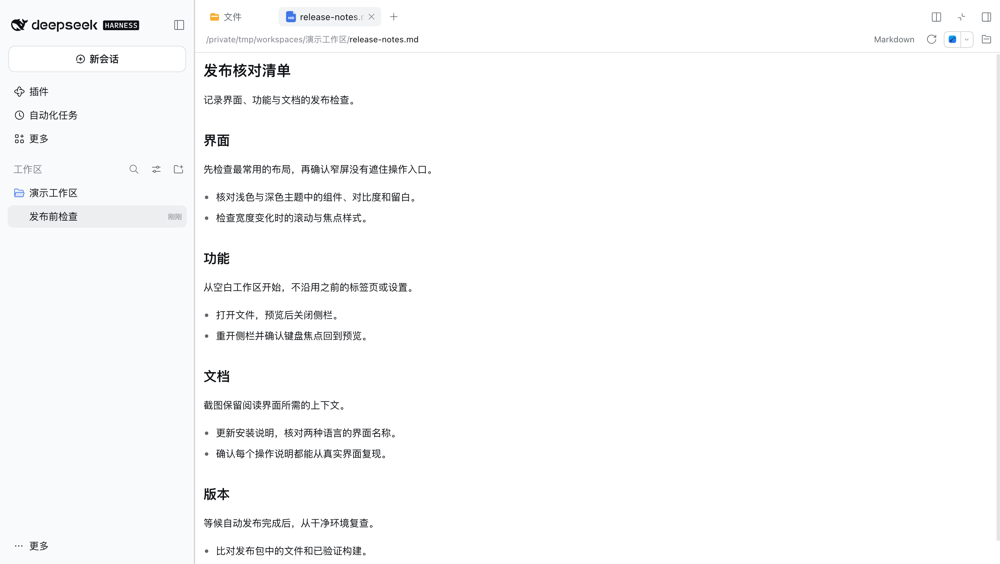

# Aggressive sidebar

[简体中文](README.zh.md)

Expand the DeepSeek Harness right sidebar on wide windows and move keyboard focus into the active page when it opens.

Choose an opening mode in **Plugins → Aggressive sidebar → Opening mode** (or on the aggregate bundle's detail page):

- **Expand to the left sidebar** (default): covers the conversation area and keeps the left sidebar usable.
- **Fullscreen**: covers the workspace.

The preference is saved in the active profile.
Below 768 px, the right sidebar uses DSH's built-in fullscreen layout; floating panels stay unchanged.

Requires DeepSeek Harness `0.2.2-rc.5` or newer (Desktop and Web).
Enable **Aggressive sidebar** in **Visual Modular Improvement Plan**, or run `pnpm install --frozen-lockfile`
in this directory and select it in **Plugins → Add plugin** (or via `install_bundle`).

## Screenshots

The screenshots show the Chinese UI with a demo Markdown preview extending to the left sidebar.

[Main view in dark mode](docs/assets/screenshots/main-dark.png)

[Project documentation](docs/README.md)
