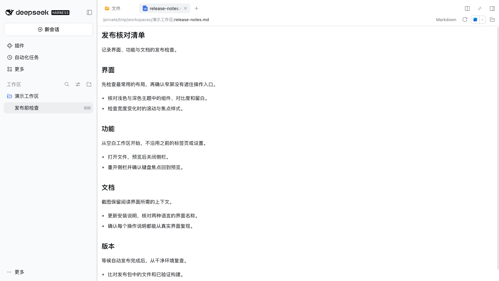

# 激进侧边栏

[English](README.md)

在宽屏下默认展开 DeepSeek Harness 的右侧栏，并在打开时将键盘焦点移入当前活动页面。

可在 **插件 → 激进侧边栏 → 展开模式**（或对应聚合插件的详情页）中选择打开方式：

- **展开到左边栏**（默认）：覆盖会话区并贴合左边栏右缘，左边栏仍可操作。
- **全屏**：覆盖整个工作区。

选择保存在当前配置文件中。窗口窄于 768 px 时采用 DSH 原生全屏布局；浮窗不受影响。

需要 DeepSeek Harness `0.2.2-rc.5` 或更新版本（支持 Desktop 与 Web）。
可在 **外观模块化改良计划** 中直接开启，
或在源码目录运行 `pnpm install --frozen-lockfile` 后从 **插件 → 添加插件** 选择本目录（也可用 `install_bundle` 安装）。

## 界面截图

演示 Markdown 预览铺满会话区，左边栏仍可见。

[深色主题](docs/assets/screenshots/main-dark.png)

[项目文档](docs/README.md)
